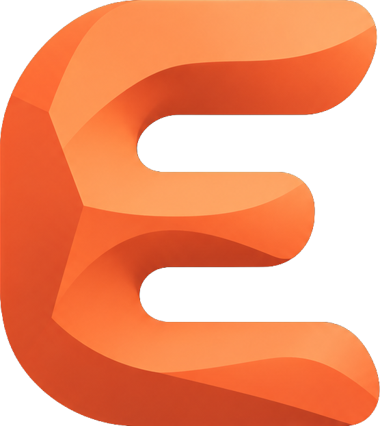
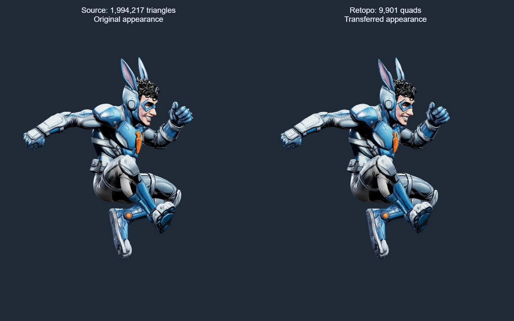
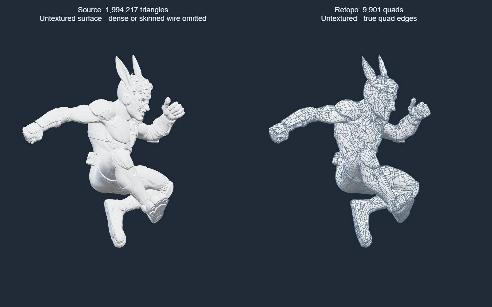
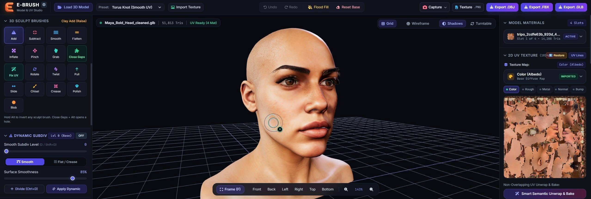
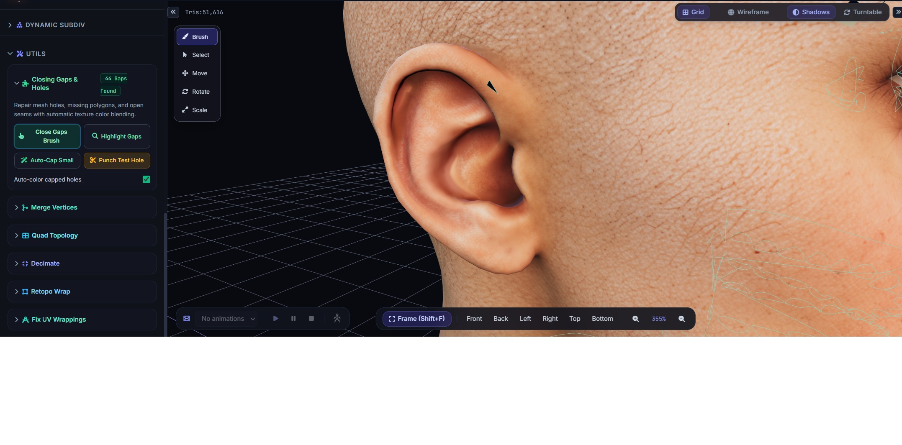

  

# E-BRUSH

**Paint textures, sculpt forms, and explore 3D models in your browser.**

Project preview · Open-source release coming soon

---

## What is E-Brush?

E-Brush is a browser-based workspace for working with 3D models and their textures. It brings painting, sculpting, scene setup, and rendering together in one place, so you can move from a model to a finished asset without switching between tools.

About **99% of E-Brush's capabilities are planned to work without running the executable**. A small number of features will require the executable version.

## Highlights

### Quad reduction and retopology

Simplify quad meshes, or retopologize a high-density model and transfer its appearance. This example compares a source with 1,994,217 triangles to a retopologized result with 9,901 quads.

### High-fidelity viewport effects

Adjust scene lighting, shadows, and camera settings to create and inspect a look directly in the viewport.

### Paint on meshes and textures

Paint directly on a 3D model or work with its UV texture while viewing the result on the mesh.

### Close gaps in meshes

Find and close gaps and holes in a mesh, including issues that can appear in AI-generated models.

## What you can do

- **Paint in 2D or on the model.** Work with brushes and texture channels while seeing the result on your 3D model.
- **Sculpt and refine.** Shape meshes with sculpt brushes, symmetry, subdivision, and mesh utilities.
- **Work with your scene.** Organize objects and materials, pose supported rigs, and adjust lights and camera settings.
- **Import and export.** Bring in common 3D model formats, save an editable EBR project, and export your work.
- **Render and capture.** Create still images and capture views of your work.

## Project status

This repository is an early preview of E-Brush. The source code is being prepared for an open-source release planned for the coming weeks.

## Follow the project

Star the repository to keep it handy, or use **Watch** to follow updates as the release approaches.
